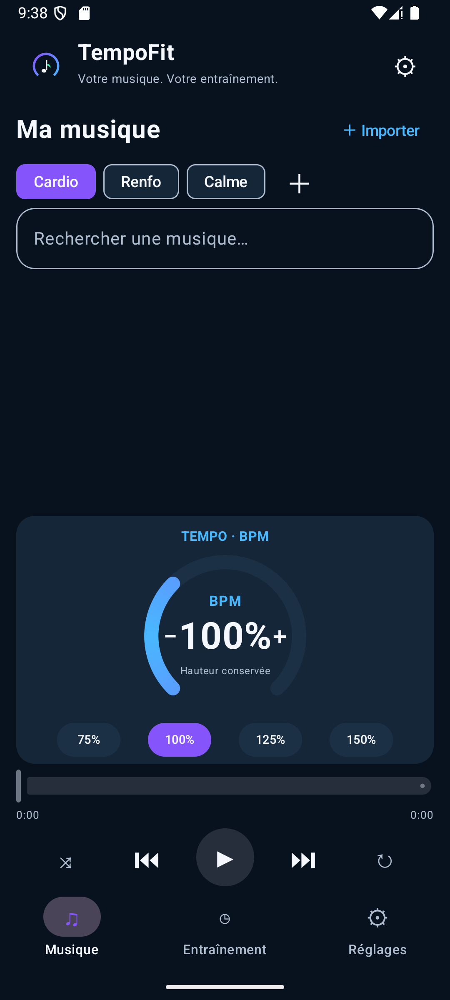
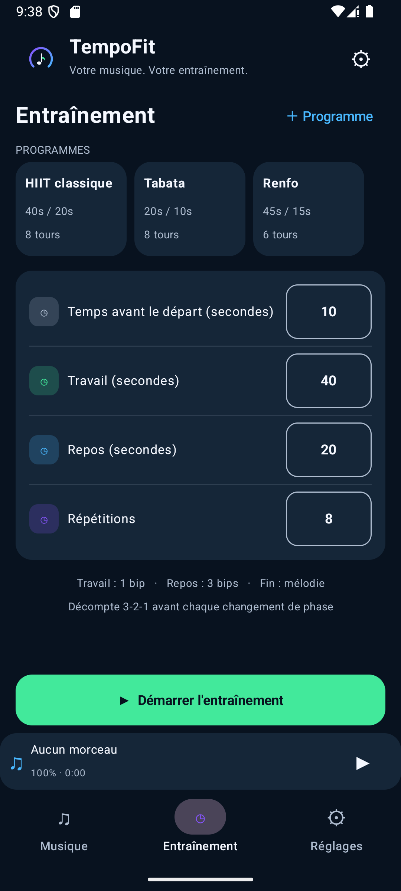
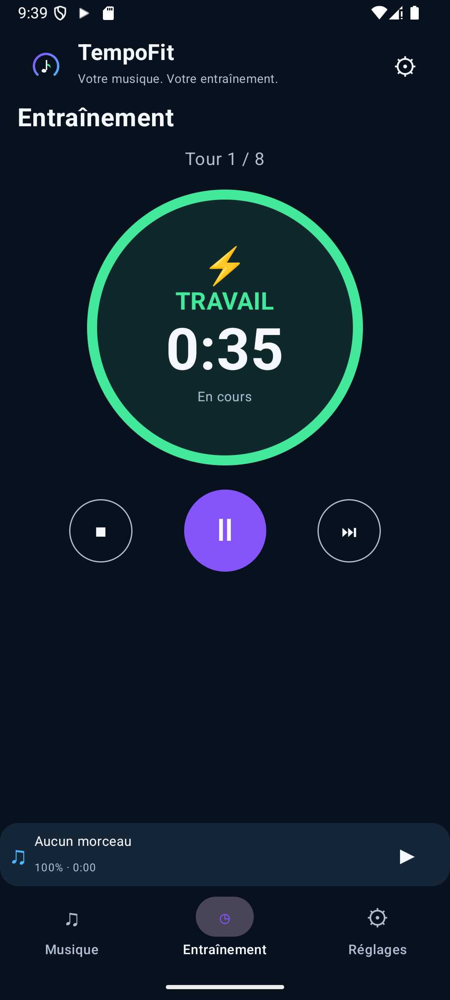
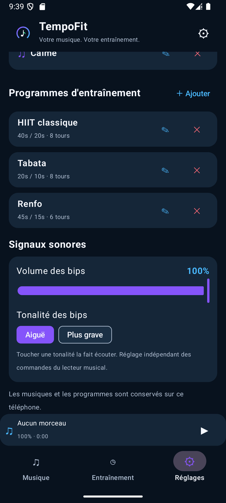

# TempoFit

Application Android qui associe un **lecteur MP3** avec réglage de tempo à un **minuteur d'entraînement par intervalles** (HIIT, Tabata, renforcement). Les signaux sonores du timer se superposent à la musique, qui baisse automatiquement pendant les bips.

Kotlin · Jetpack Compose · Media3 (ExoPlayer) · SoundPool · service au premier plan

## Fonctionnalités
- **Musique** : bibliothèque MP3 importée dans l'appli, dossiers personnalisables (Cardio, Renfo, Calme…), recherche, lecture en arrière-plan, aléatoire / répétition.
- **Tempo** : cadran tactile de 50 % à 200 % de la vitesse, hauteur conservée (ce n'est pas une détection de BPM).
- **Entraînement** : temps avant le départ, travail, repos, répétitions ; programmes enregistrables ; minuteur robuste écran éteint.
- **Signaux sonores** : bip de travail, 3 bips au repos, mélodie de fin, décompte 3-2-1 avant chaque changement de phase, volume réglable, ducking de la musique, compatible enceinte Bluetooth.

## Captures

   

## Installation
Téléchargez l'APK signé dans l'onglet **Releases** du dépôt, puis ouvrez-le sur votre téléphone Android (autorisez l'installation depuis cette source si Android le demande). Android 8.0 ou plus récent.

## Compilation
1. Ouvrir le dossier dans Android Studio (SDK Android 35).
2. `./gradlew assembleDebug` — APK : `app/build/outputs/apk/debug/app-debug.apk`.

## État
Version 0.9.4. Compilé en release signée, lancé et vérifié sur émulateur Android 15. Validé sur un téléphone réel jusqu'à la v0.9.1 ; les derniers réglages de volume, de tonalité et de décompte sont à valider à l'oreille.
